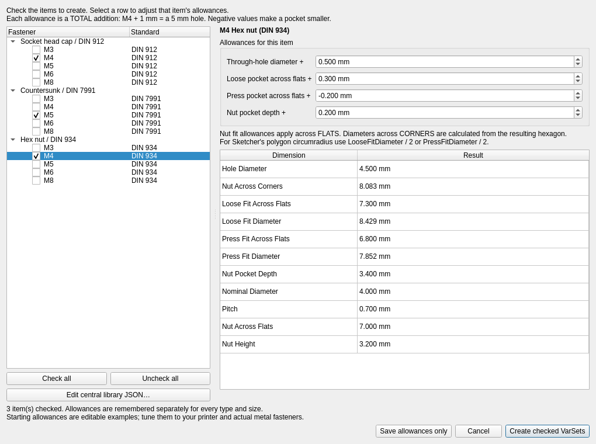

# Fastener VarSets

A small FreeCAD workbench for designing printed parts around metal screws and
nuts. Select fasteners, give each item its own print allowances, and create
ordinary native VarSets. Projects hold independent snapshots. They remain
usable without this add-on or its central library.



Includes M3, M4, M5, M6, and M8 in three families (15 items):

| Family | Base dimensions |
| --- | --- |
| Socket head cap screws | DIN 912 |
| Countersunk socket screws | DIN 7991, 90 degrees |
| Hex nuts | DIN 934 |

DIN 912 applies to socket head screws; countersunk screws and nuts use their
own DIN tables. This version uses coarse metric thread pitches.

## Install

Clone the project and install it locally (the installer supports the FreeCAD
Python module paths used by Arch Linux):

```sh
git clone https://github.com/ka-no-creativity/freecad-fastener-varsets.git
cd freecad-fastener-varsets
python install.py
```

The installer uses FreeCAD's actual `getUserAppDataDir()` and creates a workbench
link in `Mod/FastenerVarSets` and a launcher link in `Macro`. Keep this source
folder in place. It will not replace unrelated existing files.

For a portable installation, copy this whole folder into your FreeCAD user
`Mod/FastenerVarSets` folder instead. FreeCAD 1.0+ is required; tested on 1.1.4
with Qt 6. The code uses FreeCAD's PySide compatibility module.

Restart FreeCAD and choose **Fastener VarSets** from the workbench selector.
The five toolbar commands are also in the **Fastener VarSets** menu. The optional
macro opens the chooser without switching workbenches. Commands can be added
to other workbenches using FreeCAD's toolbar customization.

## Use

1. Open the part you are designing.
2. Click **Choose fasteners**.
3. Check the needed fasteners. Select each row to edit its separate allowances.
4. Click **Create checked VarSets**.
5. In a sketch constraint's expression editor, use e.g.
   `M4_SocketCap.HoleDiameter` or `M4_Nut.LooseFitAcrossFlats`.

Every allowance is a **total addition to the displayed dimension**, not per
side. `M4 + 1 mm = 5 mm` through-hole diameter. Lengths are millimetres.
Each type/size remembers its own allowances for next time.

To adjust existing items, select their VarSets in the project tree and click
**Adjust allowances**. This uses the base values saved in that project and
updates existing objects, keeping expression references intact. You can also
edit the VarSet's **Allowances** properties directly. Calculated **Cutouts**
properties update through local expressions. Use the dialog to validate new
allowances: direct property edits can create physically invalid dimensions.

Repeated creation/import always makes new copies with unique internal names.
It never replaces an existing VarSet. Use Adjust allowances when you intend
to change an existing item. Creation, import, and adjustment support Undo.

## Dimensions and allowances

| Item | Original dimensions | Independent allowances | Resulting cutout dimensions |
| --- | --- | --- | --- |
| Socket screw | nominal diameter, pitch, head diameter/height, hex-key size, tap drill | hole diameter, head recess diameter, head recess depth, tap hole diameter | `HoleDiameter`, `HeadPocketDiameter`, `HeadPocketDepth`, `TapHoleDiameter` |
| Countersunk screw | same, plus countersink angle | same four allowances | same four results, keeping cone geometry consistent |
| Hex nut | nominal diameter, pitch, across flats, height | hole diameter, loose fit across flats, press fit across flats, pocket depth | `HoleDiameter`, `LooseFitAcrossFlats`, `PressFitAcrossFlats`, `LooseFitDiameter`, `PressFitDiameter`, `NutPocketDepth` |

For nuts, the two `…FitDiameter` values are **across corners**, useful for a
circular pocket or a hexagon's circumscribed circle. For Sketcher polygon
**circumradius**, use `M4_Nut.LooseFitDiameter / 2` or
`M4_Nut.PressFitDiameter / 2`. Across-corners values use the ideal regular
hexagon relation `across flats × 2 / sqrt(3)`, rather than the catalog's minimum
corner dimension. The fit allowance is added **across flats**; the diameter
then follows from that hexagon.

For countersinks, `HeadPocketDiameter` is the mouth diameter and
`HeadPocketDepth = (HeadPocketDiameter - HoleDiameter) / (2 × tan(angle / 2))`.
The head diameter allowance widens the mouth directly. Extra depth also widens
the mouth by `2 × depth allowance × tan(angle / 2)`. This preserves the head
angle. `HeadHeight` remains the original catalog dimension; it is not the full
cone depth down to the through-hole intersection.

`TapDrillDiameter` is the usual **cutting-tap Kernloch** diameter: 2.5, 3.3,
4.2, 5.0, and 6.8 mm for M3, M4, M5, M6, and M8 respectively. `TapHoleDiameter`
adds a separate printer allowance. It is not a forming-tap size or the
theoretical thread minor diameter. Calibrate it for your printed material
before cutting threads.

Initial allowances are editable starting examples: hole +0.5, head diameter
+0.5, head depth +0.2, tap hole +0.0, loose nut across flats +0.3, press nut
across flats -0.1, nut depth +0.2 mm. They are not guaranteed fits for a printer.
Negative allowances are supported. The dialog rejects non-positive dimensions,
tap holes reaching the thread's nominal diameter, reversed loose/press fits,
and a head pocket narrower than its hole.

## Central JSON and project snapshots

**Edit central library** opens an editable JSON dialog and validates on Save.
The library affects future creations; project dimensions remain independent.
With FreeCAD 1.1 on Linux, the files normally live under:

```text
~/.local/share/FreeCAD/v1-1/FastenerVarSets/library.json
~/.local/share/FreeCAD/v1-1/FastenerVarSets/allowances.json
```

`library.json` holds editable base dimensions and their sources.
`allowances.json` holds the per-item allowances and checked selection. Both are
ordinary indented JSON. They are separate so editing a standard dimension
does not overwrite printer settings. A library entry looks like:

```json
{
  "id": "DIN912_M4",
  "label": "M4 Socket cap (DIN 912)",
  "kind": "socket_cap",
  "standard": "DIN 912",
  "size": "M4",
  "dimensions": {
    "NominalDiameter": 4,
    "Pitch": 0.7,
    "HeadDiameter": 7,
    "HeadHeight": 4,
    "SocketAcrossFlats": 3,
    "TapDrillDiameter": 3.3
  }
}
```

To transfer project VarSets, select them and choose **Export VarSets to JSON**.
With none selected, all VarSets in the active project are exported. In the next
project choose **Import VarSets from JSON**, tick the objects you need, and import.
Generated fastener snapshots can then be adjusted with **Adjust allowances**.

The exported JSON stores property types, units, groups, tooltips, values, and
local expressions. Expressions referencing other objects/documents are saved
as evaluated values, so the imported copy is independent. Export reports those
flattened expressions. Common scalar properties, enumerations, vectors and
scalar lists are supported. Unsupported property types produce an error before
writing; they are never silently omitted. Only conservative local expressions
are preserved. Object links and binary/custom properties are not supported.

## Dimension sources

The bundled JSON records the sources, so replacements can be checked easily:

- [Schrauben-Jaeger DIN 912, page 86](https://www.awh.eu/de/downloads-456.html?file=files/Demosystem/Dokumente/DIN912.pdf)
- [Aspen Fasteners DIN 7991, page 1](https://www.aspenfasteners.com/content/pdf/Metric_DIN_7991_spec.pdf)
- [Trojan Special Fasteners DIN 934](https://www.trojansf.co.uk/standards/din-934)
- [Thuermer Tools cutting-tap drill table](https://www.thurmer.com/special-sizes-faq/)

Nut heights use the DIN 934 values (e.g. M5: 4 mm, M8: 6.5 mm), not ISO 4032
heights. Measure your actual hardware when fit matters.

## Verification

```sh
python tests/test_freecad.py
python tests/test_gui.py
```

The [example project](examples/M4-example.FCStd) and
[readable JSON snapshot](examples/m4-varsets.json) contain the three M4 items.

The first test exercises actual FreeCAD VarSets, expression calculations, per-item
independence, JSON round trips, name collisions, invalid imports/rollback,
and FCStd save/reopen without scripted proxies. The second uses the real FreeCAD
GUI offscreen with isolated settings and exercises the chooser, remembered
values, snapshot editing, Undo, and import selection. Both require the installed
FreeCAD Python modules; the paths match this Arch installation.

To remove the local installation, remove only the two symlinks the installer
created. Keep the `FastenerVarSets` data folder if you want to retain your
central library and remembered allowances. Existing project VarSets remain
native FreeCAD objects.
